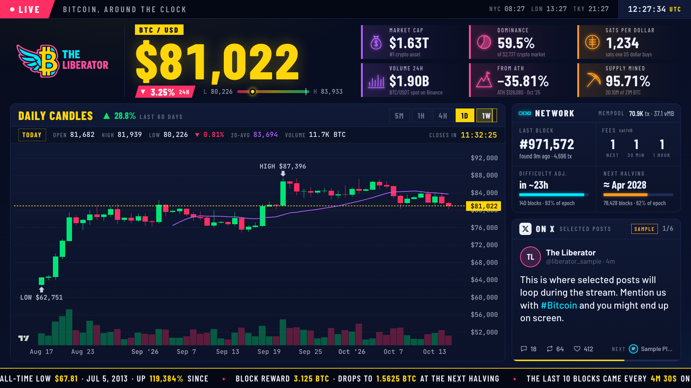

# Liberator Stream: Bitcoin Live Dashboard

```
██████╗ ████████╗ ██████╗      ██████╗  █████╗ ███████╗██╗  ██╗
██╔══██╗╚══██╔══╝██╔════╝      ██╔══██╗██╔══██╗██╔════╝██║  ██║
██████╔╝   ██║   ██║     █████╗██║  ██║███████║███████╗███████║
██╔══██╗   ██║   ██║     ╚════╝██║  ██║██╔══██║╚════██║██╔══██║
██████╔╝   ██║   ╚██████╗      ██████╔╝██║  ██║███████║██║  ██║
╚═════╝    ╚═╝    ╚═════╝      ╚═════╝ ╚═╝  ╚═╝╚══════╝╚═╝  ╚═╝
```



A 24/7 live Bitcoin dashboard built as a broadcast graphic for a YouTube live stream. A Node.js backend pulls data from several public APIs (with fallbacks) and pushes it over a WebSocket to a React page designed on a fixed 1920×1080 canvas.

## Status (October 2026)

| Area | State |
| --- | --- |
| "On Air" broadcast redesign | Done |
| Live price | Done: Binance WebSocket, about 1 update/s, REST fallback |
| Network data (blocks, fees, mempool) | Done: Blockstream |
| Hosting | The old Render deployment (btc-dash.com) is retired; the domain isn't serving the app |
| 24/7 YouTube stream | **In progress:** a background streamer on a Mac (see below) |
| Selected-posts ("ON X") loop | Placeholder: shows sample posts with a SAMPLE tag until a backend sends `tweets` |

## What's on screen

- **On-air bar:** LIVE (turns DELAYED if the price stalls for 45 s, RECONNECTING if the server connection drops), world clocks, UTC clock.
- **Header:** logo, live price with a per-tick readout and the 24 h range, six metric plates (market cap, dominance, sats per dollar, 24 h volume, distance from the all-time high, supply mined).
- **Chart:** candles that rotate through 5M / 1H / 4H / 1D / 1W every 60 s, with a logo wipe on each switch. The last candle follows the live price. Also volume, a 20-period average, high/low markers, a plain-language legend and a candle-close countdown.
- **Network panel:** last block, fees, mempool, difficulty adjustment and halving countdowns.
- **ON X:** rotating selected posts.
- **Ticker:** only facts not shown anywhere else on screen.

## Architecture

One Koa backend (`backend/`) serves the API, the WebSocket and the built React app (`frontend/build`).

| Data | Source (fallbacks) | Refresh |
| --- | --- | --- |
| Price, 24 h stats | Binance WebSocket; REST only while the stream is down (Binance → CoinGecko → CoinPaprika → CoinCap) | ~1 s (REST every 30 s) |
| Candles | Binance (CoinGecko) | 5M: 1 min · 1H: 5 min · 4H: 30 min · 1D: 12 h · 1W: 24 h |
| Block, fees, mempool | Blockstream | 1 min |
| Supply, ATH | CoinGecko (CoinPaprika, CoinCap) | 30 min |
| Dominance, total market | CoinGecko (CoinPaprika) | 15 min |

Clients get the full data once on connect and on changes, plus small (~200 byte) price ticks once a second. Details for contributors are in [CLAUDE.md](CLAUDE.md).

## Run it locally

Requires Node 22.

```bash
make install   # root, backend and frontend dependencies
make build     # production build of the frontend
make start     # backend on http://localhost:3001 (serves the built app)
```

`make dev` runs the frontend dev server (port 3000) and the backend with auto-reload.

The page is designed for 1920×1080 and scales to fit any window.

### Configuration (environment variables)

| Variable | Default | Purpose |
| --- | --- | --- |
| `PORT` | `3001` | Backend port |
| `COINGECKO_API_KEY` | none | Optional; avoids CoinGecko free-tier rate limits |
| `BINANCE_WS_URL` | Binance market-data stream | Comma-separated override for the live price stream |
| `PRICE_STREAM` | on | `off` disables the WebSocket and polls REST every 30 s |
| `REACT_APP_WS_URL` | same host | Frontend build-time override for the WebSocket URL |

### Monitoring

- `/api/health`: is the app up
- `/api/stats`: scheduler, cache, live price stream health, skipped REST polls
- `/api/adapters`: health of each API source
- `/api/cache`: current data
- `/api/memory`: process memory

## Streaming to YouTube (in progress)

The plan is to run it all on one Mac, with no cloud hosting:

1. The backend runs locally as a macOS `launchd` service.
2. A streamer service opens `localhost:3001` in headless Chrome at 1920×1080 and captures it at 30 fps (about 1 core on an M2).
3. It encodes with ffmpeg on the Mac's hardware encoder (`h264_videotoolbox`, ~4.5 Mbps) and sends RTMPS to YouTube.
4. `launchd` and a watchdog restart anything that stalls, and `caffeinate` keeps the Mac awake.

## Development

```bash
make test      # backend + frontend tests
make lint      # ESLint (+ Prettier rules)
make format    # Prettier
```

## Project structure

```
liberator-stream/
├── backend/
│   └── src/
│       ├── adapters/     # Binance, CoinGecko, CoinPaprika, CoinCap, Blockstream
│       ├── cache/        # cache + schema/validation
│       ├── config/       # timeframes and refresh intervals
│       ├── services/     # scheduler, API manager, Binance ticker stream
│       ├── websocket/    # client WebSocket server
│       ├── __tests__/
│       └── app.js
├── frontend/
│   ├── assets/           # original logo artwork (source)
│   ├── public/           # index.html, recoloured logo
│   └── src/
│       ├── components/   # Stage, OnAirBar, PriceSection, Chart, NetworkPulse, SocialWire, Ticker, Logo, Sketch
│       ├── data/         # sample posts for the ON X loop
│       ├── hooks/, utils/, theme/
│       └── __tests__/
├── Makefile
└── CLAUDE.md
```
